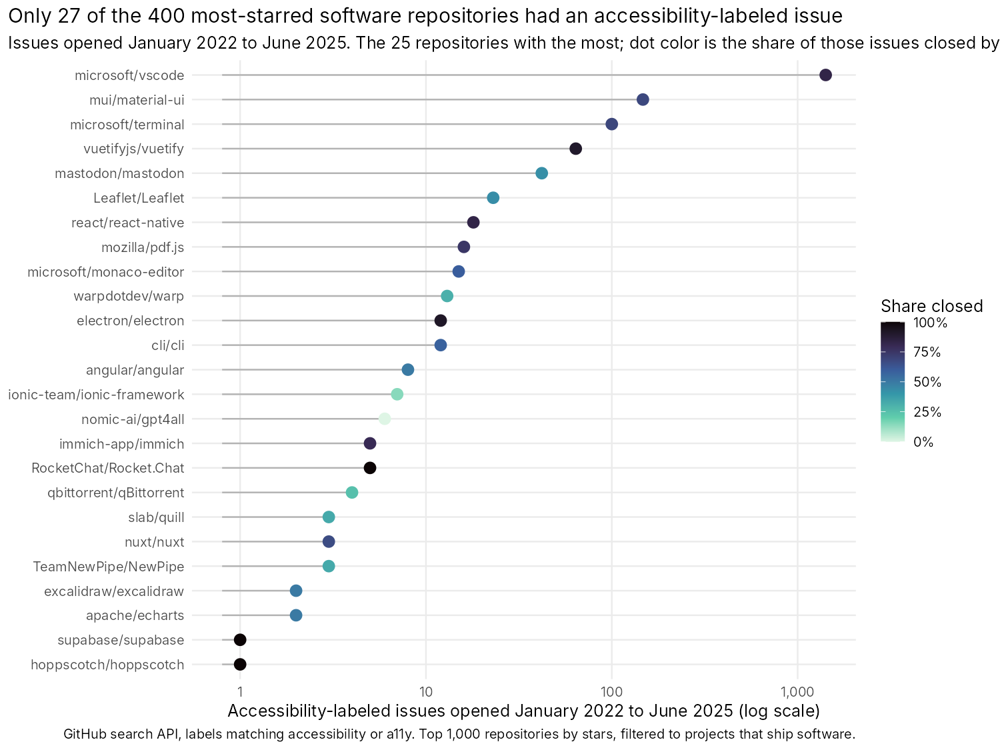
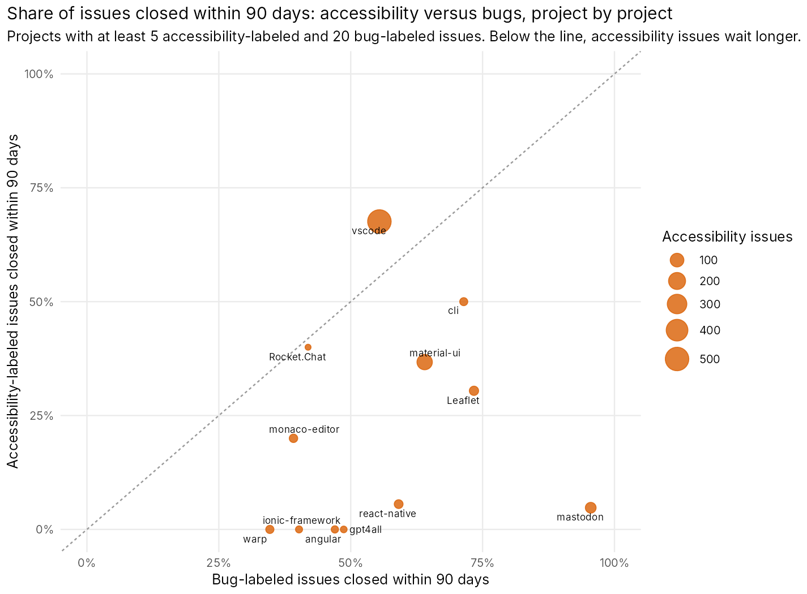
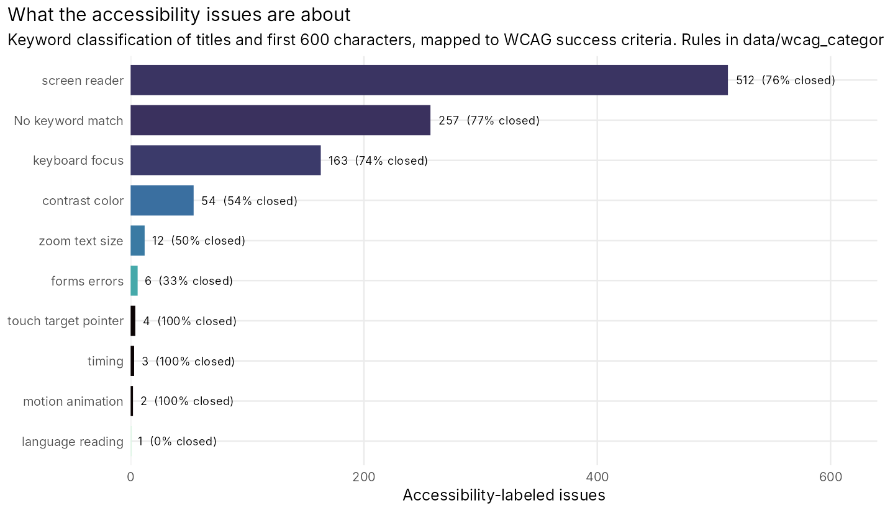

# How open source handles accessibility bugs

Every accessibility-labeled issue opened between January 2022 and June 2025 in the 400 most-starred software repositories on GitHub, followed to October 2026, next to a sample of the same projects' bug-labeled issues. Who labels accessibility at all, how long those issues wait compared with ordinary bugs in the same project, what they are about in WCAG terms, and whose reports get closed as "not planned."

I did this because the GitHub accessibility role I applied for is a program management job, and the first thing a program manager needs is a baseline. Collected with the unauthenticated GitHub search API in rate-limited bursts (973 requests), analyzed in R with survival models.

## What the data show

- **Most big projects do not have an accessibility label.** 27 of the 400 repositories (7 percent) had at least one accessibility-labeled issue in the three and a half years; 12 had ten or more. 235 of the 400 had a bug label. Across all 400, 1,930 issues carried an accessibility label against 211,144 that carried a bug label: under one percent.
- **One project is most of the field.** microsoft/vscode accounts for 1,416 of the 1,930 accessibility-labeled issues, and it files, triages, and closes them at the pace of its bugs (68 percent closed within 90 days, against 55 percent of its bugs). After VS Code, the list drops to mui/material-ui (147), microsoft/terminal (100), vuetifyjs/vuetify (64), mastodon/mastodon (42), and Leaflet (23). TypeScript projects are 13 of the 27; 1 of 96 Python projects has the label.
- **In the same project, an accessibility issue is closed at 0.6 times the rate of a bug.** A Cox model stratified by repository and adjusted for opening year, over 4,284 issues in the 19 projects that label both, gives a closure hazard ratio of 0.61 (95 percent CI 0.54 to 0.69). Half of bugs are closed within 53 days; half of accessibility issues take 79.
- **Take VS Code out and the ratio is 0.30.** In the other 18 projects, 25 percent of accessibility issues were closed within 90 days against 55 percent of bugs, 37 percent within a year against 68, and the median accessibility issue was still open after two and a half years (890 days against 55). Mastodon closed 5 percent of its accessibility issues within 90 days and 96 percent of its sampled bugs. material-ui: 37 against 64. Leaflet: 30 against 73. angular, ionic-framework, warp, and gpt4all closed none of theirs within 90 days.
- **Outside reporters wait longest.** Accessibility issues filed by maintainers and members were closed within 90 days 72 percent of the time; those filed by people with no prior association with the project, 40 percent, and 16 percent of those were closed as "not planned" (5 percent for maintainers' own). For bugs the outsider gap is small (54 against 56 percent).
- **Half of the issues are screen reader and ARIA problems.** A keyword classification of titles and bodies puts 512 of 1,014 collected accessibility issues under name, role, value, and relationships (WCAG 4.1.2 and 1.3.1), 163 under keyboard and focus (2.1.1, 2.4.7, 2.4.3), and 54 under color and contrast (1.4.3, 1.4.1, 1.4.11). Contrast issues are the ones that sit: 54 percent closed, 24 percent within 90 days. 257 issues matched no keyword rule.








### Project by project, 90 days

| Project | Accessibility issues | Bugs sampled | Accessibility closed in 90 days | Bugs closed in 90 days | Accessibility closed not planned |
|---|---|---|---|---|---|
| microsoft/vscode | 500 | 193 | 68% | 55% | 13% |
| mui/material-ui | 147 | 189 | 37% | 64% | 11% |
| mastodon/mastodon | 42 | 200 | 5% | 96% | 7% |
| Leaflet/Leaflet | 23 | 199 | 30% | 73% | 0% |
| react/react-native | 18 | 22 | 6% | 59% | 28% |
| microsoft/monaco-editor | 15 | 189 | 20% | 39% | 13% |
| warpdotdev/warp | 13 | 199 | 0% | 35% | 23% |
| cli/cli | 12 | 196 | 50% | 71% | 0% |
| angular/angular | 8 | 200 | 0% | 47% | 25% |
| ionic-team/ionic-framework | 7 | 194 | 0% | 40% | 0% |
| nomic-ai/gpt4all | 6 | 189 | 0% | 49% | 0% |
| RocketChat/Rocket.Chat | 5 | 198 | 40% | 42% | 0% |

VS Code's 500 are the most recent 500 of its 1,416 (the search API returns at most 1,000 results and the collector stops at five pages). microsoft/terminal, vuetify, pdf.js, and electron have accessibility labels but no label the collector recognizes as "bug," so they appear in the counts but not in the comparison. Full table: `output/per_repo_comparison.csv`.

## How it was built

**Repositories.** The 1,000 most-starred public, unarchived repositories (the search API's ceiling), filtered to projects that ship software: a primary language in a list of programming languages, issues enabled, and no description or name matching a list of words that mark curated lists, books, tutorials, interview prep, roadmaps, templates, and the like. The first 400 that pass are the sample; stars run from 40,000 to 393,000. `data/raw/repos_candidates.json` holds all 1,000 so the filter can be audited.

**Issues.** For each repository, two searches over issues opened January 1, 2022 to June 30, 2025: one for thirteen spellings of an accessibility label (`accessibility`, `a11y`, `area: accessibility`, `Area-Accessibility`, and so on; the list is in `scripts/collect.py`), up to 500 issues; and one for five spellings of a bug label (`bug`, `type: bug`, `kind/bug`, `Type: Bug`, `bug report`), the most recent 200. An issue carrying both labels counts as accessibility. The window ends in June 2025 so every issue had at least 15 months to be closed before the October 2026 pull.

**Time to close.** Days from opening to closing; open issues are censored at the pull date. Medians come from Kaplan-Meier curves, not from the closed issues alone, so an unresolved issue counts as "longer than this" rather than disappearing. The Cox models are stratified by repository, which means each project is compared only with itself, and adjusted for opening year because the bug sample is the most recent 200 per project and skews later. A stricter check that keeps only issues opened after the later of a project's first sampled bug and first accessibility issue gives a hazard ratio of 0.49 (`output/cox_models.csv`).

**WCAG categories.** Ordered regular expressions over the title and the first 600 characters of the body, first match wins; the rules and the criteria they map to are in `data/wcag_categories.csv`. It is a keyword classifier, not a judgment of each issue, and the "no keyword match" bar is its error term.

## Limits

- **Labels are the detector.** A project that fixes accessibility bugs without labeling them is invisible here, and a project with an unusual label name (`a11y: keyboard`, `♿`) is undercounted. The 7 percent is the share of top projects that use a recognizable accessibility label, which is itself the finding, but it is not the share that cares.
- **The bug sample is the latest 200 per project.** For a project like VS Code that is a few weeks of bugs. The survival analysis handles the shorter follow-up, and the year adjustment and the strict-window model handle the timing, but the bug sample is still "recent bugs" rather than "bugs from the same years."
- **Closing is not fixing.** `state_reason` separates `completed` from `not_planned` and `duplicate`, and the tables report the not-planned share, but a `completed` close can be a fix, a wontfix without the label, or a bot sweep. Comments and reactions are in the data for anyone who wants to go further.
- **Search API ceilings.** 1,000 results per query for repositories and issues, 10 requests a minute without a token. The collector is resumable and ran in roughly three-minute bursts over two hours.
- **VS Code is 500 of the 809 accessibility issues in the comparison and 73 percent of the field.** Both versions of every number are reported; pick the one that answers your question.

## Reproducing it

```
python3 scripts/collect.py work --budget 165 --repos 400     # repeat until it prints "all repositories done"
python3 scripts/build_tables.py work data                     # data/repos.csv, data/issues.csv, data/wcag_categories.csv
Rscript analysis.R                                            # output/ and figures/
```

`collect.py` uses only the standard library and the unauthenticated API; set `--budget` to how long each run may take before it stops cleanly (it keeps its place in `work/state.json`). The raw `issues.jsonl` it writes (33 MB, with body excerpts) is not in this repository; `data/issues.csv` is the deduplicated, classified version with titles, labels, dates, and outcomes. `analysis.R` needs `tidyverse`, `scales`, `survival`, and `ggrepel`.

Sources: [GitHub REST API, search issues and pull requests](https://docs.github.com/en/rest/search/search#search-issues-and-pull-requests); [WCAG 2.2](https://www.w3.org/TR/WCAG22/).

## Files

| Path | What it is |
|---|---|
| `data/issues.csv` | 31,096 issues: repository, number, group, title, labels, state and reason, dates, days to close or censor, 30/90/365-day flags, comments, reactions, author association, WCAG category |
| `data/repos.csv` | The 400 repositories with stars, language, and the accessibility and bug issue totals the API reported |
| `data/wcag_categories.csv` | The classification rules |
| `data/raw/` | The repository candidate list, the kept list, the collector's state file, and its log |
| `scripts/collect.py`, `scripts/build_tables.py` | Collect and tidy |
| `analysis.R` | Survival curves, Cox models, per-project comparison, categories, author association |
| `output/summary_by_group.csv`, `output/cox_models.csv` | The headline comparison under four sample definitions |
| `output/per_repo_comparison.csv`, `output/repos_with_accessibility_issues.csv` | Project tables |
| `output/by_wcag_category.csv`, `output/by_author_association.csv`, `output/by_quarter.csv`, `output/coverage_by_language.csv` | Breakdowns |
| `output/readme_tables.md`, `output/headline_numbers.txt` | Summary tables |
| `figures/` | Five charts |

Code is MIT licensed. The issue data are public GitHub metadata and are released under CC0.
